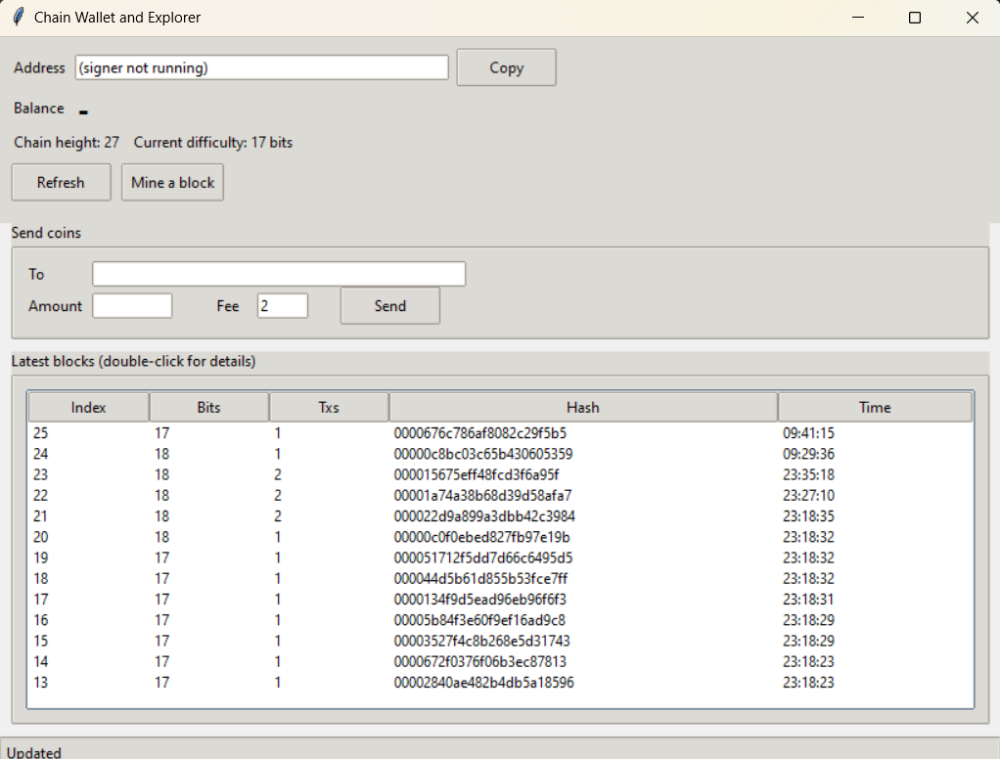
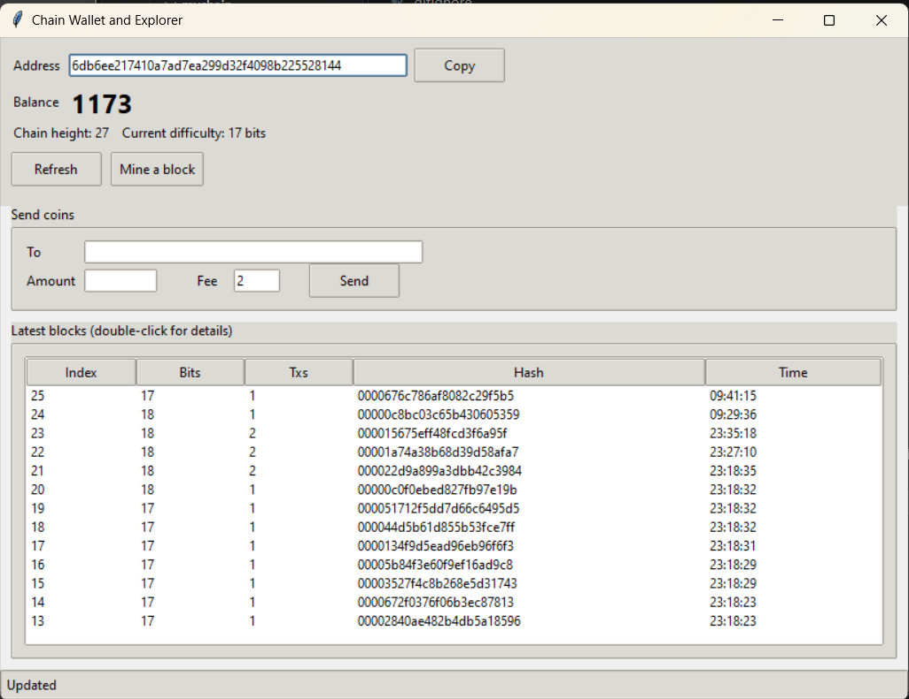

# Achain

A small proof-of-work blockchain written in Python, with signed transactions, fees, automatic difficulty adjustment, a separate signing process, a hardened network node and a desktop interface.

> **Status: learning prototype. Do not use it to hold, secure or transfer anything of real value.** It demonstrates the rules of a secure ledger on one machine. It does not provide network-level security, which depends on many independent miners. See [Limitations](#limitations).

## Screenshots

The explorer works with only the node running. The wallet area shows that no signer is connected.



With the signer running, the window shows the wallet address and balance and enables mining and sending.



## Features

- **Hash-linked blocks.** Each block stores the SHA-256 hash of the previous one, computed over canonical JSON, so editing any old block breaks the chain.
- **Proof of work with adjustable difficulty.** Difficulty is the number of leading zero bits. From block 10, and every 5 blocks after that, the chain compares the last 5 blocks with a target of 2 seconds each and raises or lowers the difficulty by one bit (limits: 8 to 40 bits). Every validator recomputes the required difficulty.
- **Signed transactions.** Ed25519 signatures cover the whole transaction. A per-sender nonce blocks replays, and the minimum fee is 1.
- **Rewards and fees.** The coinbase pays the miner 50 plus the block's fees. It is the only way coins are created.
- **Full validation.** Mining, loading a saved chain and receiving a peer's chain all replay everything from the first block. A node adopts a peer's chain only if it is valid and holds more total work.
- **Safe storage.** The chain file is written atomically and re-validated on load, so an edited file stops the node from starting. Wallet keys are stored as password-encrypted PEM files.
- **Separate signer.** `signer.py` holds the key, builds and signs transactions itself, refuses amounts above 500 and asks for approval on every request. The node, wallet command line and interface never see the key.
- **Hardened node.** A secret token for operator endpoints, a 256 KB request limit, a 100 requests per minute limit per client address, peer URL validation and saved peers.
- **Desktop interface.** A Tkinter window with address, balance, a send form, a mine button and a block explorer.

## Requirements

- Python 3.9 or newer
- Packages in `requirements.txt` (`cryptography`, `flask`, `requests`)
- Tkinter for the interface. It ships with Python. On Windows, make sure "tcl/tk and IDLE" is ticked in the installer.

## Quick start

```
git clone https://github.com/Adaba2006/achain.git
cd achain
python -m venv venv
venv\Scripts\activate            # Windows
source venv/bin/activate         # Linux or macOS
python -m pip install -r requirements.txt
```

Create a wallet. You will be asked for a password, which protects the key file:

```
python -c "from chaincore import Wallet; import getpass; Wallet().save('wallet.pem', getpass.getpass('New wallet password: '))"
```

Open three terminals in the project folder, activate the virtual environment in each, and run one command per terminal:

```
python node.py 5000
python signer.py wallet.pem
python gui.py
```

1. Click **Mine a block**. The first coins are the block reward (50).
2. To send coins, create a throwaway recipient with `python -c "from chaincore import Wallet; print(Wallet().address)"`, paste the address into **To**, enter an amount and a fee, and click **Send**.
3. Approve the request in the signer terminal by typing `y`.
4. Mine another block to confirm the transaction.
5. Double-click any block in the table to see its full contents.

The node creates `chain_5000.json` and `node_token.txt` on first use. To point the interface at another node, run `python gui.py http://127.0.0.1:5001`.

## Command line wallet

The same actions are available without the interface (the node and signer must be running):

```
python wallet.py address
python wallet.py balance
python wallet.py send <address> <amount> --fee 2
python wallet.py mine
```

## Demos and tests

Each script shows a rule being enforced against a deliberate attack or error.

| Script | What it shows |
| --- | --- |
| `stage1.py` | Hash links detect edits to old blocks |
| `stage2.py` | Proof of work protects the last block too |
| `stage3.py` | Signatures, replay protection, overspending |
| `demo_net.py` | Difficulty adjustment, fees and syncing between two nodes (run `node.py 5000` and `node.py 5001` first) |
| `demo_signer.py` | The signer's approval step and spending limit |
| `demo_hardening.py` | Token, size limit, peer validation and rate limit |

## Project layout

| File | Role |
| --- | --- |
| `chaincore.py` | Blocks, hashing, proof of work, difficulty, transactions, validation, wallet and chain storage |
| `node.py` | Network node with its protections |
| `auth.py` | Finds and supplies the node token |
| `signer.py` | Separate signing process |
| `wallet.py` | Command line wallet |
| `gui.py` | Desktop interface |

## Limitations

- It runs on one machine. Resistance to rewriting history depends on many independent miners, so a small network could be overtaken by an attacker with more computing power.
- Transactions are not broadcast between nodes, and pending transactions are included first come, first served, so a higher fee does not buy faster inclusion.
- Signed transactions carry no chain identifier, so the same key used on another chain of the same design could be replayed there.
- The token travels over plain HTTP, the rate limit is per address, and the node uses Flask's development server.
- Keys are protected by software only. Malware running as the user could read the signer's memory.
- The reward is constant with no supply cap.

## Security notes

- Never publish `*.pem`, `node_token.txt`, `chain_*.json` or `peers_*.json`. The included `.gitignore` excludes them.
- Treat `node_token.txt` and your wallet password like passwords.

## Licence

This project is **source-available, not open source**. You may read, run and modify it for personal, educational and research use. Selling it, or using it in a commercial product or service, needs the author's written permission. See [LICENSE](LICENSE).

For commercial use or to buy a copy, contact: https://github.com/Adaba2006.
